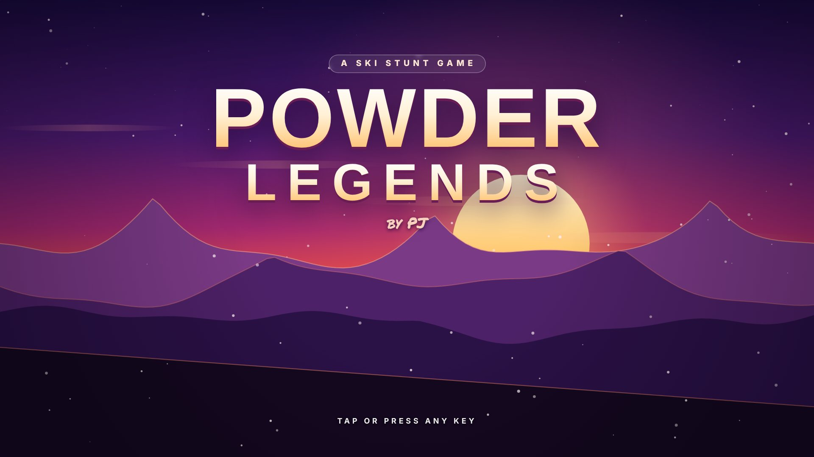
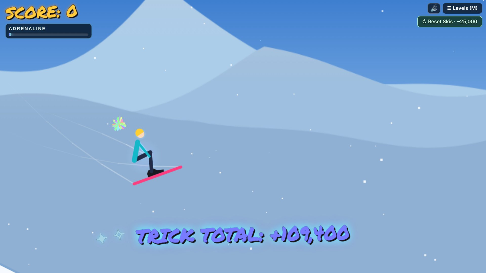
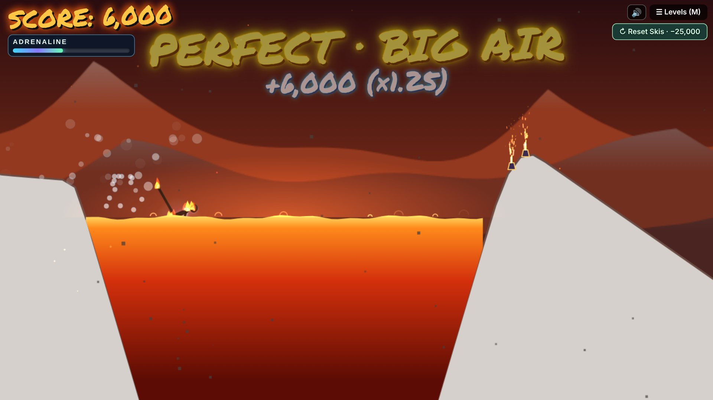
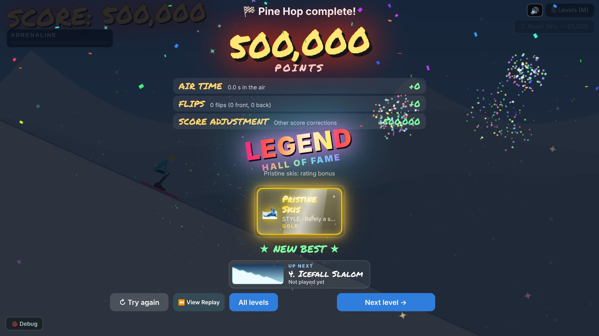
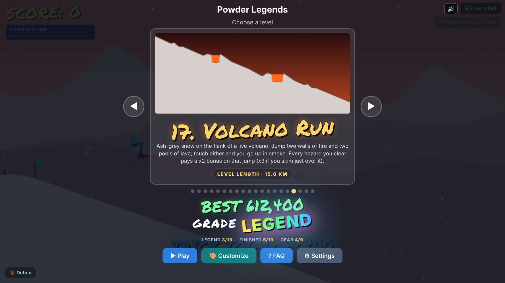
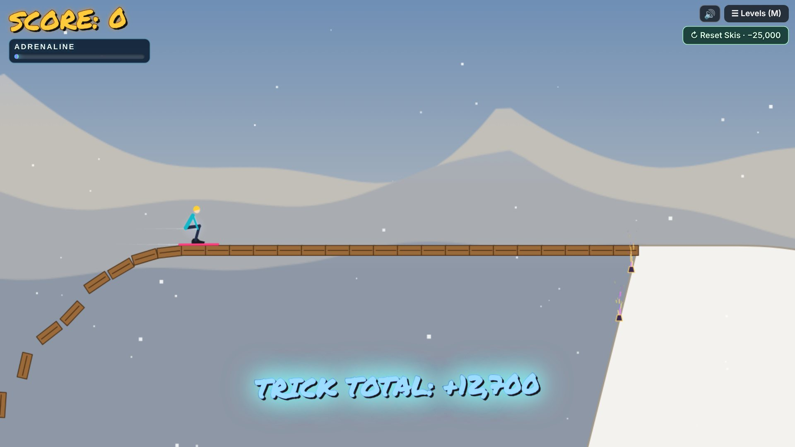
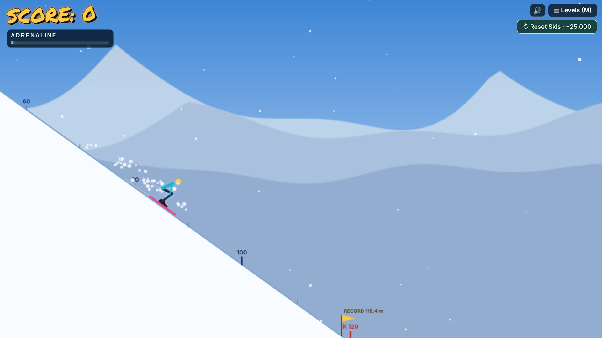
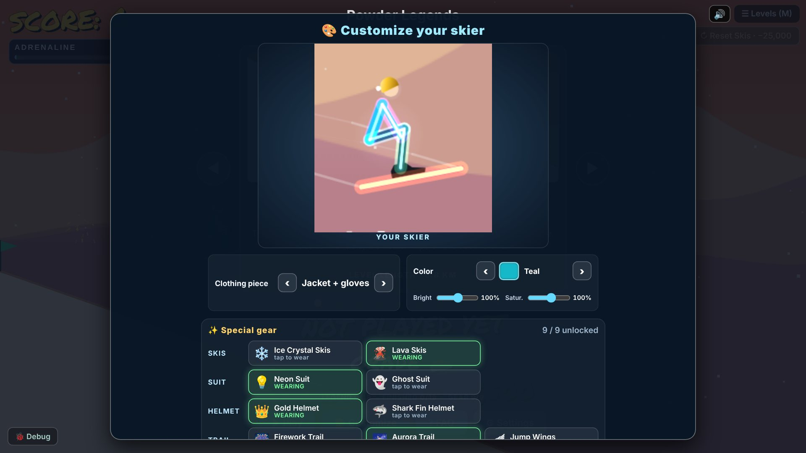
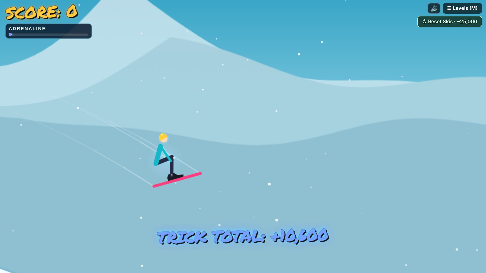
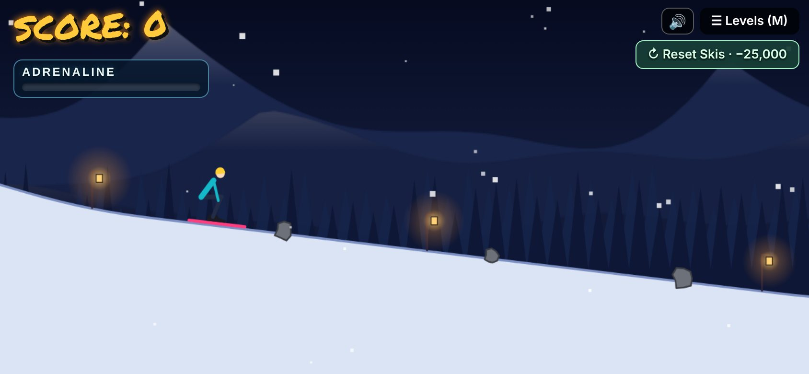

<h1 align="center">⛷️ Powder Legends</h1>

<b>A physics ski-stunt game you play in your browser.</b> 
Huck kickers, spin flips, clear lava pits and shark pools, and stomp the landing.

  <a href="https://kefirman9000.github.io/powder-legends/"><b>▶ Play now</b></a> ·
  <a href="https://github.com/kefirman9000/powder-legends/raw/main/index.html">Download</a> (right-click → Save link as… · one file, works offline)

No install, no account, no ads. It runs on desktop and on phones, and it updates itself when a new version is out.

---

## What makes it fun

<table>
<tr>
<td width="50%"></td>
<td width="50%"></td>
</tr>
<tr>
<td><b>Real physics, real tricks.</b> Your skier is a ragdoll you steer with small movements. Crouch on the ramp, pop at the lip, tuck to spin, and open up before you land.</td>
<td><b>Land it clean.</b> Every landing is graded on how flat your skis hit the snow: <i>PERFECT</i> pays extra, <i>NOT FLAT</i> pays nothing. Clear hazards like lava, fire walls and sharks for big bonuses.</td>
</tr>
<tr>
<td></td>
<td></td>
</tr>
<tr>
<td><b>Chase LEGEND.</b> Every run is graded from F up to <b>LEGEND</b>, with awards for flips, air time, style and speed.</td>
<td><b>19 levels plus Ski School.</b> Each level card shows your best score and grade, and the menu tracks your progress through the game.</td>
</tr>
<tr>
<td></td>
<td></td>
</tr>
<tr>
<td><b>Levels with personality.</b> Collapsing bridges, avalanche runs, crate stacks, quarter pipes, a lantern-lit night forest, and a mountain that never ends.</td>
<td><b>Records to beat.</b> Ski Jump Hill measures every jump against your hill record, and the Endless Run keeps going until your first crash.</td>
</tr>
<tr>
<td></td>
<td></td>
</tr>
<tr>
<td><b>Unlock glowing gear.</b> Lava skis, a neon suit, a gold helmet, aurora trails and more, earned by finishing levels. Mix them with your own colors.</td>
<td><b>Race your ghost.</b> Your best run on each level plays back as a see-through ghost, so there's always someone to beat.</td>
</tr>
</table>

 
Plays great on phones too: drag to move, hold a second finger to brake.

## The levels

| | | |
|---|---|---|
| 1. **Ski School**: learn the moves | 2. Sunset Double | 3. Pine Hop |
| 4. Icefall Slalom | 5. Avalanche Escape | 6. Lantern Forest |
| 7. Crate Stack | 8. Rickety Bridge | 9. Fireworks Hill |
| 10. Mogul Field | 11. Glacier Run | 12. Quarter Pipe |
| 13. **Ski Jump Hill**: distance record | 14. Mega Ramp | 15. Inferno Walls |
| 16. Shark Pool | 17. Volcano Run | 18. Death Valley |
| 19. The Long Haul | 20. **Endless Run**: no finish line | |

## How to play

**Start with Ski School.** It walks you through everything in about two minutes.

| | Mouse | Touch |
|---|---|---|
| Crouch / stand | Move down / flick up | Drag down / flick up |
| Lean back / tuck forward | Move left / right | Drag left / right |
| Brake | Hold the left button | Hold a second finger down |
| Restart | Right-click or **R** | Tap after a wipeout |

Other keys: **M** or **Esc** for the menu · **N** next level · **1–9** pick a level · **F** fullscreen · scroll or **+ / −** to zoom.

**Tips**
- Only mouse *movement* counts, and your pose stays where you leave it.
- Tuck tight to spin faster, and stand up straight before you land.
- Big, clean landings fill the adrenaline bar. Keep it full for a rainbow trail.
- Struggling on an older phone? **Settings → Graphics** lowers the effects. On Auto, it does this for you.

## Credits

Made by **PJ**. Built with plain HTML and JavaScript; no libraries, no tracking.

Want to tinker with it? See **[DEVELOPING.md](DEVELOPING.md)** for how the game is built and how updates ship.
